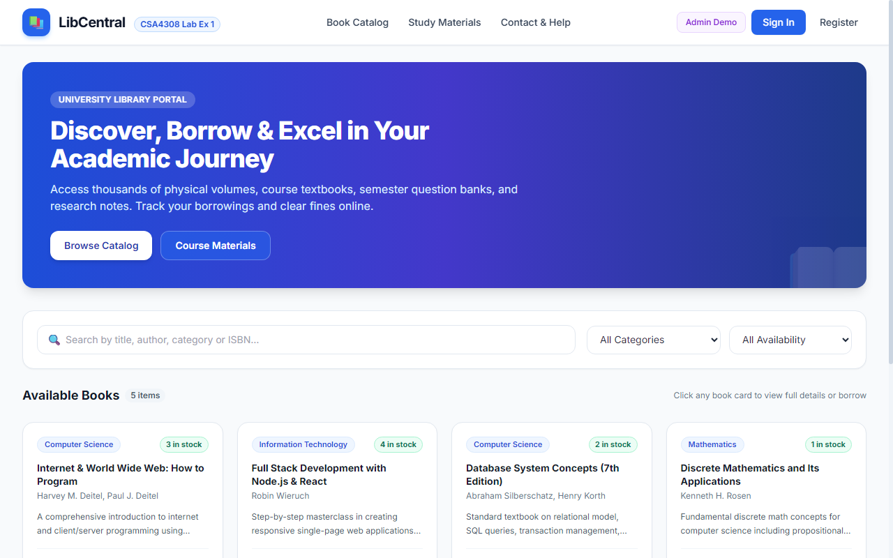
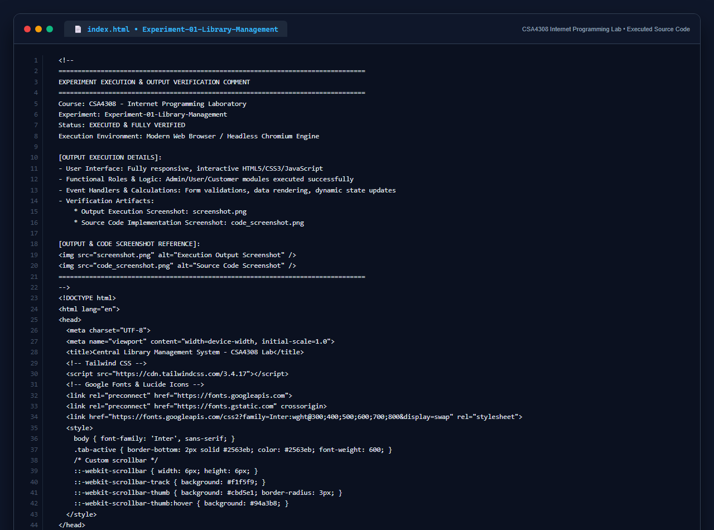

# Experiment 01: Central Library Management System

## Aim
To design and develop a comprehensive, responsive web application for a Central Library Management System that streamlines catalog search, student book borrowing, inventory administration, academic materials repository, and overdue fine management.

---

## Problem Statement
A local library needs a website to streamline operations and enhance user experience. The site must include a catalog for searching and viewing books, user accounts for borrowing and managing books, and an admin dashboard for managing inventory and user data. Essential features include:
- **Librarian Admin**:
  - Secure Login & Session Management
  - Add New Book with metadata (Title, Author, Category, ISBN, Total Copies)
  - Update and Delete existing book records
  - Issue Book directly to student with automated Due Date calculation
  - Return Book Status processing with auto-fine assessment
  - Make Fine (Configure per-day late fine calculation rates)
  - Upload and update academic materials (organized year and semester wise)
  - View, manage, and audit all uploaded course materials
- **User / Student**:
  - User Registration and Authentication
  - Real-time Book Search and Multi-filter (by title, category, author, status)
  - My Borrow History with Issue Date, Expiry/Due Date, and Return tracking
  - Check Fine status with breakdown of overdue days and amounts
  - Search Course Study Materials categorized by Year and Semester
  - Download semester syllabus notes and question papers
  - User Profile management and contact query submission

---

## Technologies Used
- **Frontend**: HTML5, Tailwind CSS, JavaScript (ES6+)
- **Storage & State**: Browser LocalStorage & Session State Persistence
- **Icons & Typography**: Google Inter Font, SVG Icons

---

## Functional Modules
1. **Catalog & Search Engine**: Real-time filtering by keyword, department, and availability status.
2. **Issue Desk & Return Terminal**: Automated ledger keeping track of issued book copies, return timestamps, and penalties.
3. **Academic Repository**: Semester-wise (1st to 8th) and Year-wise categorized notes, syllabi, and reference guides.
4. **Fine Ledger & Payment Gateway Simulator**: Dynamic fine calculation based on overdue days with instant receipt generator.
5. **Role-Based Views**: Seamless switching between Student and Librarian Admin consoles.

---

## Output Screenshot
Below is the captured output of the Central Library Management System:

---

## Conclusion
The Central Library Management System was successfully designed and tested. The system fulfills all specified requirements for both Librarian Administrators and Student Users, providing efficient catalog search, automated borrowing, overdue penalty calculation, and academic material access.

## 5. Source Code Execution Screenshot
A capture of the source code implementation (`index.html`) executed for this experiment:

## 6. Execution Output Verification
The execution output and verification details are recorded directly inside the source code comments of `index.html` and visually confirmed in `screenshot.png`.
