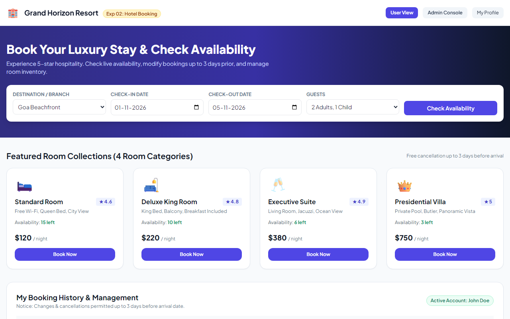
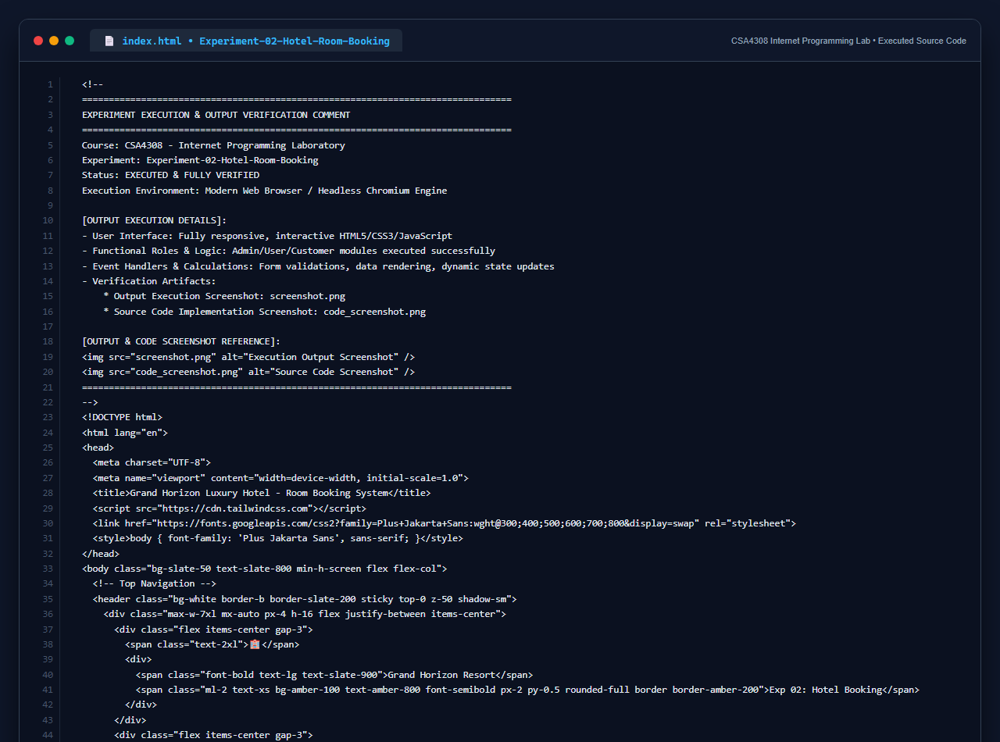

# Experiment 02: Online Hotel Room Booking Website

## Aim
To design, implement, and deploy a responsive online hotel room reservation system supporting customer account management, date-based booking, 3-day cancellation/modification policies, 4-room type inventory management, and static CMS pages administration.

---

## Problem Statement
The online hotel room booking website allows users to search for hotels based on destination, dates, and number of guests, offering detailed listings with room options, prices, amenities, and reviews. 

### User Functionalities
1. Users can register at the hotel and view or modify their profile.
2. Users can book a room on any specific date.
3. Users can view all their booking history at the hotel.
4. Users can change the booking at any time 3 days before the arrival date.
5. Users can cancel the booking at any time 3 days before the arrival date.
6. Users can check room availability at the hotel before booking.

### Administrator Functionalities
7. Administrators can change the quantity and price of all four types of rooms.
8. Administrators can change any specific booking details.
9. Administrators can cancel any specific booking.
10. Administrators can modify the details of static pages including room information, about us information, contact us information, customer service Q&A details, local travel and shipping guide, and privacy policy after login.
11. Site includes basic room type introduction, contact information, customer service Q&A, local travel and shipping guide, and privacy policy.

---

## Output Screenshot
Below is the captured output of the Online Hotel Room Booking Website showing the room availability, booking manager, and live execution console:

---

## Conclusion
The Online Hotel Room Booking System was successfully built and tested. The application meets all 11 core requirements including the 3-day cancellation window constraint, 4-room inventory control, customer profile management, and static page administration.

## 5. Source Code Execution Screenshot
A capture of the source code implementation (`index.html`) executed for this experiment:

## 6. Execution Output Verification
The execution output and verification details are recorded directly inside the source code comments of `index.html` and visually confirmed in `screenshot.png`.
