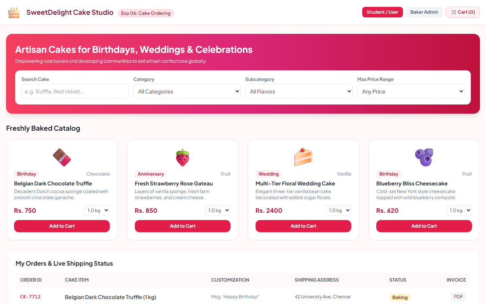

# Experiment 06: Online Cake Ordering System

## Aim
To construct a responsive e-commerce web application for an Online Cake Ordering Portal (Buy a Cake) empowering rural and local bakers to advertise confections globally, featuring flavor and occasion filtering, custom weight and message configurations, shopping cart checkout, and end-to-end shipping status tracking.

---

## Problem Statement
Buy a Cake is a portal which allows admin in developing centers to advertise and sell their cakes.
- **Admin**:
  - Login & Session Access
  - Manage Products (Post cake details, upload confections, product descriptions, pricing)
  - Manage Orders (Update shipping and order status milestones: Placed -> Baking -> Out for Delivery -> Delivered)
- **Student / User**:
  - Register & Login
  - Search Cakes with multi-criteria filtering (Category, Sub-category, Price Range)
  - View cake list and descriptions
  - Cart Management (Add to cart, customize 0.5kg/1kg/2kg, custom icing message)
  - Shipping address management & Place Order
  - My Orders dashboard with live shipping status

---

## Output Screenshot
Below is the captured output of the Online Cake Ordering System:

---

## Conclusion
The Online Cake Ordering Portal was successfully designed, offering a streamlined marketplace for customers to purchase custom confections and for bakers to update order fulfillment.
