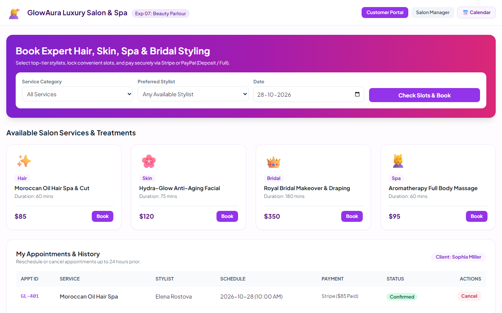
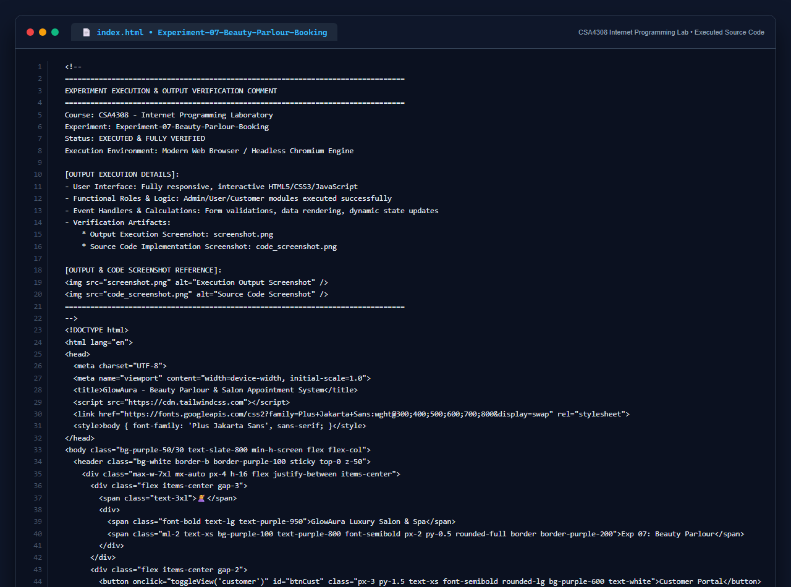

# Experiment 07: Online Beauty Parlour Appointment Booking System

## Aim
To engineer a responsive web application for an Online Beauty Parlour Appointment Booking System featuring service selection, stylist profile matching, interactive calendar scheduling with hour lockout controls, customer history tracking, SMS/call dispatch simulation, and multi-gateway online payments (Stripe/PayPal full or partial deposit).

---

## Problem Statement
The beauty parlour booking website enables customers to search services, select dates/times, and book stylists.

### Functional Modules
- **Reservations Calendar**: Create, edit, and cancel reservations; lockout unavailable hours; view calendar dates.
- **Customer Personal Account**: Upcoming reservations, past reservation history, personal profile.
- **Salon Manager & Staff View**: Control and manage reservations, add/edit appointments, trigger SMS or voice calls, and audit customer reviews.
- **Payment Processing**: Full payment or partial 30% deposit with Stripe or PayPal simulation.

---

## Output Screenshot
Below is the captured output of the Online Beauty Parlour Appointment Booking System:

---

## Conclusion
The Beauty Parlour Appointment Booking system satisfies all required capabilities for customers, stylists, and managers.

## 5. Source Code Execution Screenshot
A capture of the source code implementation (`index.html`) executed for this experiment:

## 6. Execution Output Verification
The execution output and verification details are recorded directly inside the source code comments of `index.html` and visually confirmed in `screenshot.png`.
