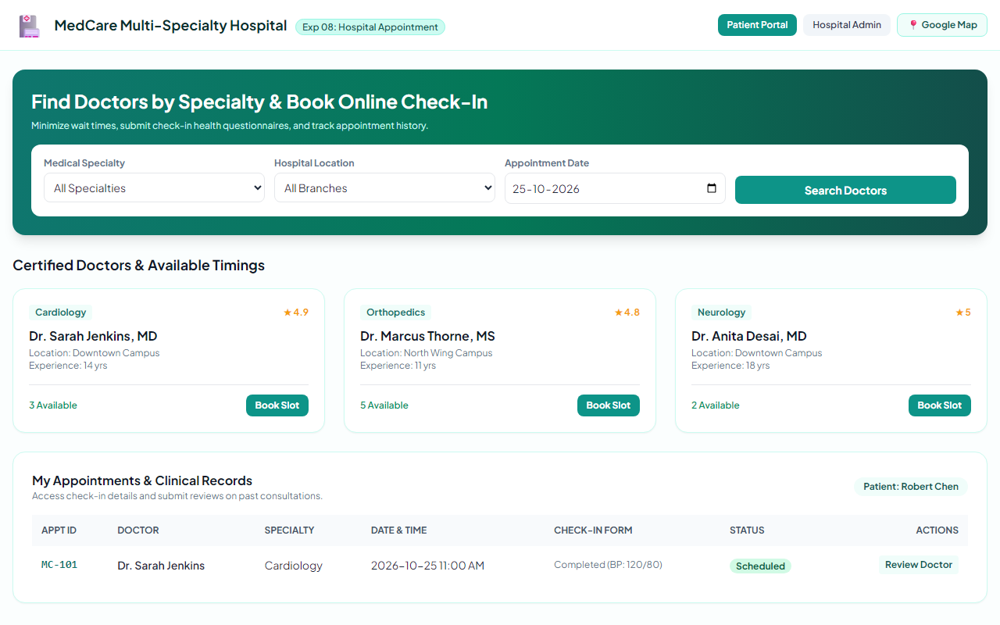
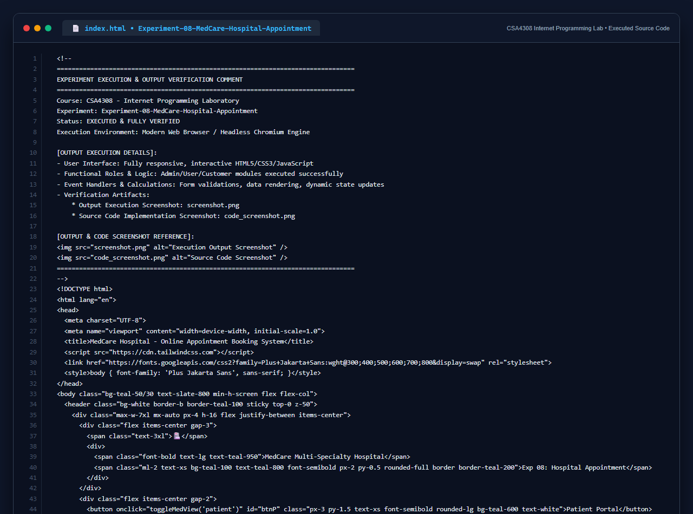

# Experiment 08: MedCare Hospital Online Appointment Booking System

## Aim
To develop a responsive, healthcare-compliant web portal for MedCare Hospital enabling patients to search specialists by medical field and hospital branch, complete pre-check-in forms, book flexible time slots, review doctor ratings, inspect location maps, and provide administrative hospital and doctor roster oversight.

---

## Problem Statement
MedCare Hospital aims to reduce wait times, minimize paperwork, and provide a seamless booking experience for patients and healthcare providers.

### Roles & Modules
- **Patient Features**: Signup/Login, Doctor search by specialty & location, flexible slot booking, pre-check-in health form submission, review doctors, view hospital list and Google Map coordinates.
- **Admin Features**: Manage appointments, maintain doctor roster, audit appointments statistics and patient sentiment ratings.
- **Hospital Features**: Hospital details creation and location management.

---

## Output Screenshot
Below is the captured output of the MedCare Hospital Appointment Portal:

---

## Conclusion
The MedCare Hospital Appointment System was fully developed and validated against all functional requirements.

## 5. Source Code Execution Screenshot
A capture of the source code implementation (`index.html`) executed for this experiment:

## 6. Execution Output Verification
The execution output and verification details are recorded directly inside the source code comments of `index.html` and visually confirmed in `screenshot.png`.
