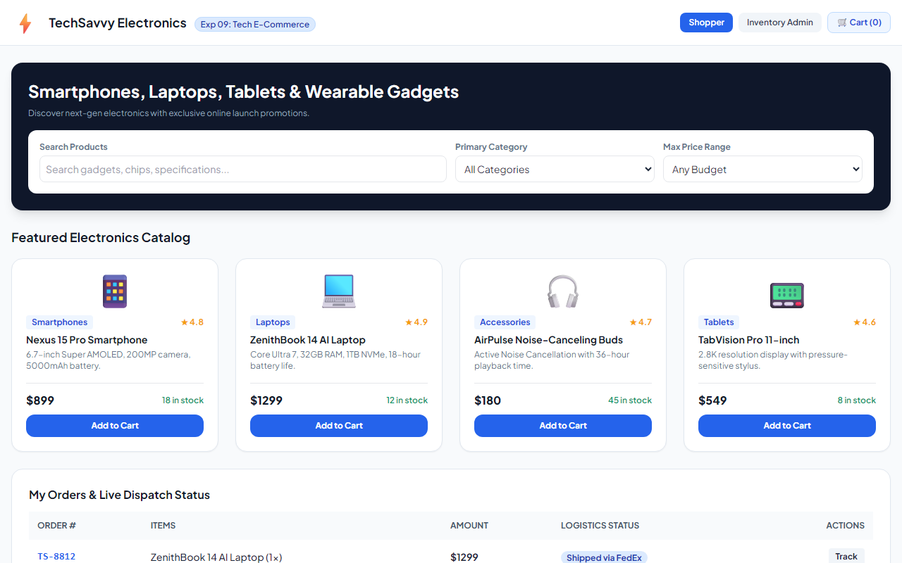

# Experiment 09: TechSavvy Electronics Gadgets Shop

## Aim
To design an interactive e-commerce platform for electronic gadgets featuring product catalog categorization (Smartphones, Laptops, Tablets, Accessories), search and price filtering, shopping cart operations, checkout processing, order status tracking, and administrative inventory modification.

---

## Problem Statement
TechSavvy features a wide range of electronic products categorized for easy browsing.
- **Customer Use Cases**: Browse categories, search items, check availability, add/edit/remove items from cart, checkout, check order status, view order history.
- **Admin Use Cases**: Add new items, remove items, modify prices and descriptions, view information about each customer who checks out.

---

## Output Screenshot
Below is the captured output of the TechSavvy Electronic Gadgets Shop:

---

## Conclusion
The TechSavvy online shop successfully satisfies all 13 listed use cases for customers and administrators.
