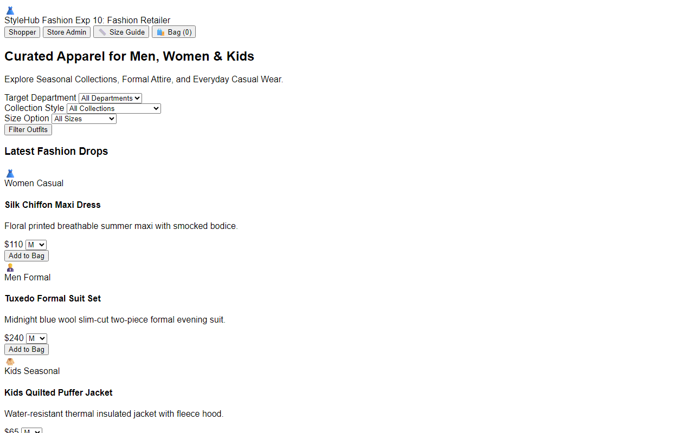

# Experiment 10: StyleHub Premier Online Fashion Retailer

## Aim
To implement a premier online fashion e-commerce platform catering to Men, Women, and Children across Casual Wear, Formal Attire, and Seasonal collections, equipped with interactive size guides, bag checkout, order tracking, and a 15-day return and exchange policy.

---

## Problem Statement
StyleHub offers an extensive collection of clothing, footwear, and accessories with user-friendly navigation and logical categorization.
- **Customer Features**: Advanced search and filtering, high-resolution product showcase, interactive size guides, bag management, checkout, order tracking, and easy return/exchange requests.
- **Admin Features**: Add particulars to catalog, update prices and descriptions, remove items, and audit customer checkout records.

---

## Output Screenshot
Below is the captured output of the StyleHub Fashion Retailer Store:

---

## Conclusion
The StyleHub e-commerce application meets all specified functional guidelines including size guides, multi-department filtering, and return policy workflows.
