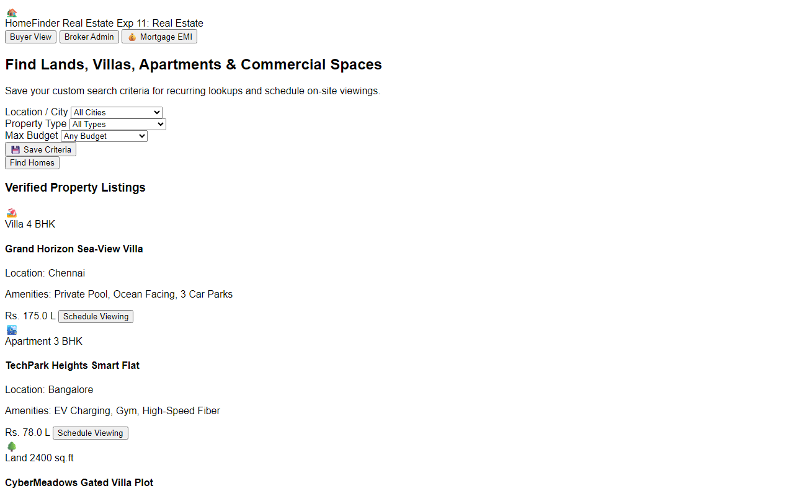

# Experiment 11: Home Finder Real Estate Platform

## Aim
To engineer an interactive online real estate platform enabling property buyers and renters to discover residential and commercial plots, save search criteria, schedule on-site viewings, estimate mortgage EMIs, and allow brokers to manage listings and track customer visit records.

---

## Problem Statement
Home Finder simplifies the property search and transaction process.
- **Buyer Features**: Search criteria persistence across visits, interactive neighborhood mapping, property viewing scheduler, mortgage EMI calculator, direct agent messaging.
- **Admin & Broker Features**: Maintain property inventory, property valuation estimator, advertisements management, and customer visit logger.

---

## Output Screenshot
Below is the captured output of the Home Finder Real Estate Platform:

---

## Conclusion
The Home Finder platform was successfully developed, meeting all search criteria persistence, viewing scheduling, and broker administration requirements.
