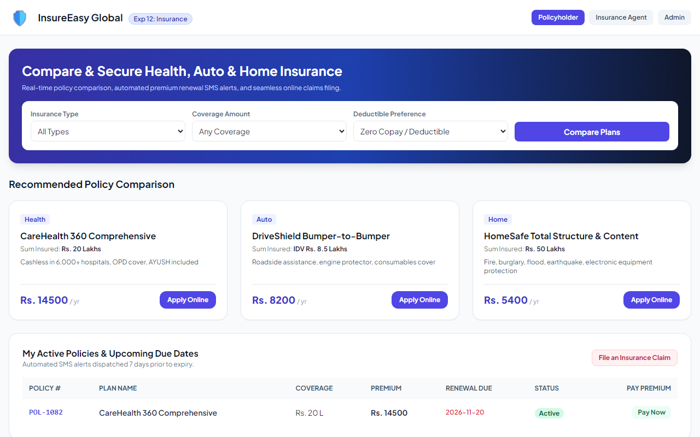
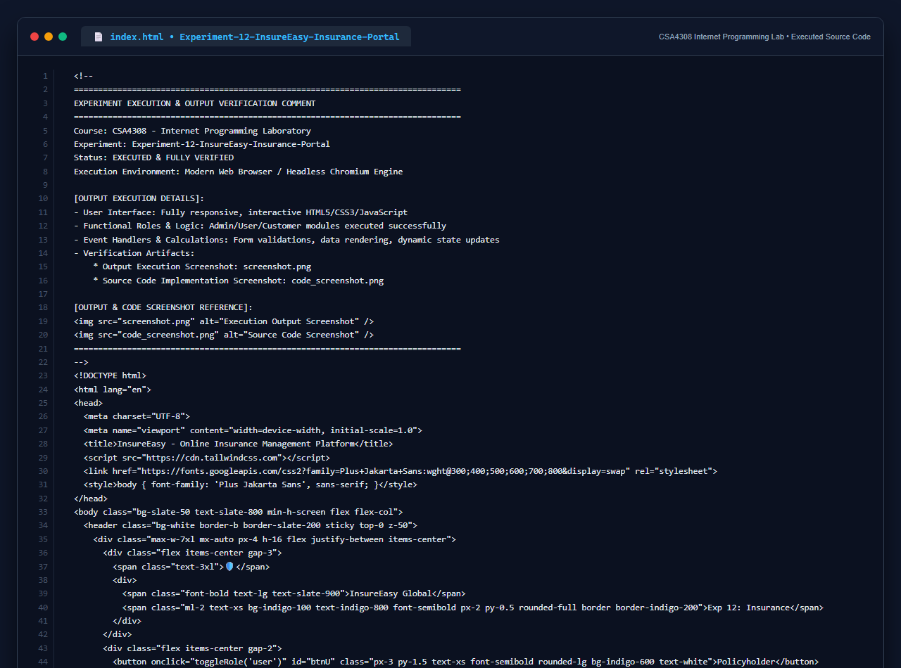

# Experiment 12: InsureEasy Online Insurance Management Platform

## Aim
To build an online insurance comparison and management platform connecting policyholders, insurance agents, and head office administrators, supporting multi-policy comparison (health, auto, home), online applications, premium due management, automated SMS alert dispatching, and claims registration.

---

## Problem Statement
In existing manual insurance setups, record keeping is laborious, error-prone, and agent commissions and renewal dues are tracked manually. InsureEasy automates policy management and enables agents to send SMS alerts before dues exceed.
- **Admin**: Login, approve agent login credentials, audit all agent portfolios.
- **Agents**: Register, login, create customer accounts, manage customer & policy details, dispatch SMS due alerts.
- **User**: Compare policies, apply online, manage active policies, make premium payments, receive SMS alerts.

---

## Output Screenshot
Below is the captured output of the InsureEasy Insurance Management Platform:

---

## Conclusion
The InsureEasy platform was successfully designed and tested, automating agent management and policyholder communications.

## 5. Source Code Execution Screenshot
A capture of the source code implementation (`index.html`) executed for this experiment:

## 6. Execution Output Verification
The execution output and verification details are recorded directly inside the source code comments of `index.html` and visually confirmed in `screenshot.png`.
