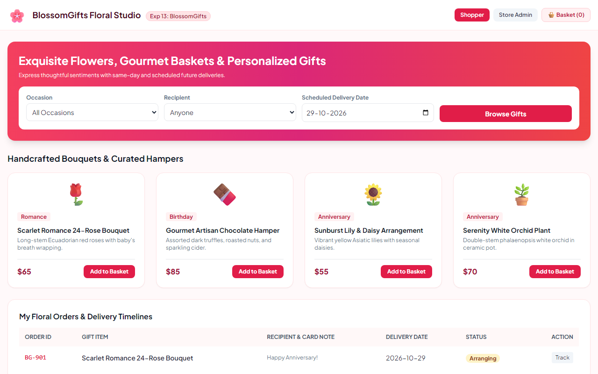

# Experiment 13: BlossomGifts Floral & Gift Basket Ordering

## Aim
To implement an online gifting and floral arrangement store featuring occasion and recipient based categorization, custom delivery date selection, greeting card inscription, shopping cart operations, and administrative inventory and checkout control.

---

## Problem Statement
BlossomGifts offers diverse floral arrangements, gift baskets, and personalized gifts organized by occasion, recipient, and price range.
- **Customer Use Cases**: Browse occasions, search gifts, add/edit/remove basket items, custom delivery date & greeting note, checkout, track order status.
- **Admin Features**: Maintain inventory particulars, modify pricing, and review information of customers who complete checkout.

---

## Output Screenshot
Below is the captured output of BlossomGifts Floral Studio:

---

## Conclusion
The BlossomGifts e-commerce portal successfully satisfies all required use cases and customer/admin workflows.
