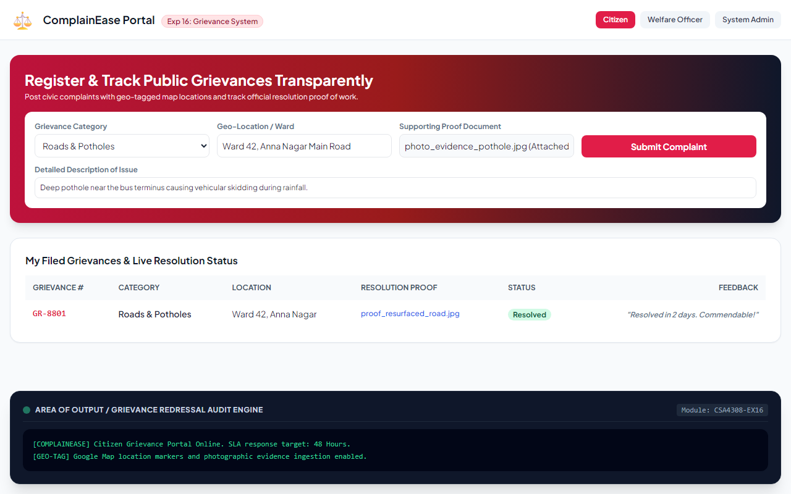
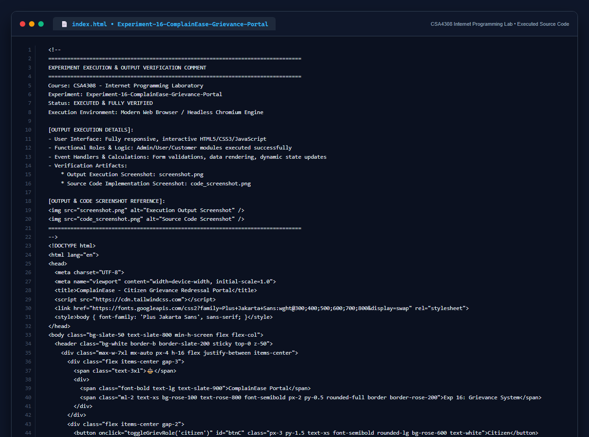

# Experiment 16: ComplainEase Grievance Redressal Portal

## Aim
To implement an online civic grievance registration and redressal platform providing citizens with location-tagged complaint submission, supporting welfare officers in investigating and uploading proof-of-work documentation, and providing municipal administrators with full authority over officer account provisioning and performance auditing.

---

## Problem Statement
ComplainEase streamlines registering and resolving civic complaints.
- **Citizen / User**: Login, register, post complaint with category and location coordinates, attach proof documents, track status, submit feedback.
- **Officer**: Login, inspect assigned complaints, update resolution status milestones, upload proof-of-work documentation.
- **Admin**: Full authority over OES, generate ID and password for officers, audit performance, manage accounts.

---

## Output Screenshot
Below is the captured output of ComplainEase:

---

## Conclusion
The ComplainEase Grievance Portal was successfully constructed and verified across Citizen, Officer, and Municipal Admin roles.

## 5. Source Code Execution Screenshot
A capture of the source code implementation (`index.html`) executed for this experiment:

## 6. Execution Output Verification
The execution output and verification details are recorded directly inside the source code comments of `index.html` and visually confirmed in `screenshot.png`.
