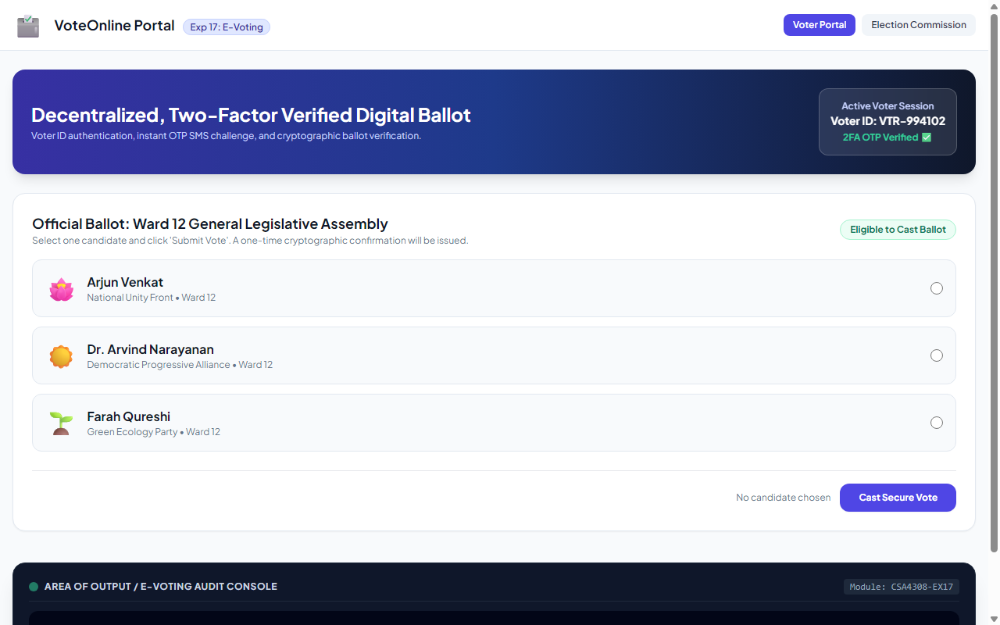

# Experiment 17: VoteOnline Secure E-Voting Platform

## Aim
To implement a secure, verifiable electronic voting platform featuring Voter ID authentication, multi-factor OTP verification, candidate ballot casting, cryptographic receipt generation, and real-time election commission results tallying.

---

## Problem Statement
VoteOnline facilitates transparent remote voting for elections.
- **Admin**: Create election candidates, allocate candidates to election wards, maintain voter registry, compute live turnout, publish election results.
- **Voter / Citizen**: Login via Voter ID, OTP verification, receive voting authorization OTP, select candidate, submit ballot, inspect confirmation receipt.

---

## Output Screenshot
Below is the captured output of VoteOnline:

---

## Conclusion
The VoteOnline platform was successfully developed, meeting all multi-factor authentication, cryptographic ballot verification, and real-time tallying requirements.
