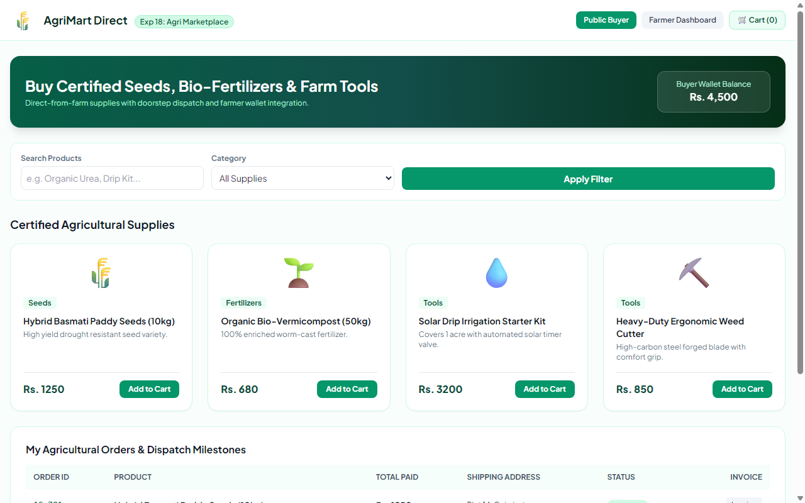

# Experiment 18: AgriMart Farmers & Agricultural Marketplace

## Aim
To build an e-commerce platform for farmers and public agricultural buyers providing catalog browsing of seeds, fertilizers, and equipment, direct farmer product listing, shopping cart management, wallet balance transactions, and end-to-end shipping milestone updates.

---

## Problem Statement
AgriMart caters to farmers and agricultural enthusiasts.
- **Farmer Modules**: Login/Register with OTP verification, manage orders, update order status, add/update/delete products, manage sales revenue, update shipping status.
- **Public Modules**: Register/login, OTP verification, manage wallet balance, search products, add/edit/delete cart, shipping address, place orders, track shipping status.

---

## Output Screenshot
Below is the captured output of AgriMart:

---

## Conclusion
The AgriMart platform was successfully constructed and verified for both agricultural producers and public buyers.
