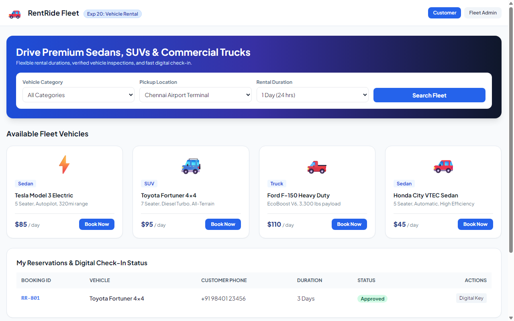

# Experiment 20: RentRide Vehicle Rental System

## Aim
To implement a modern online vehicle rental platform featuring fleet browsing across Sedans, SUVs, and Trucks, digital check-in reservation forms, customer booking tracking, and administrative fleet and booking approval management.

---

## Problem Statement
RentRide simplifies vehicle hiring:
- **User / Customer**: Search vehicles by type, rental duration, and location; inspect specs & pricing; submit bookings with customer phone & address; view booking status.
- **Admin**: Add new fleet vehicles, configure daily rental tariffs, approve customer reservations, and oversee dispatch.

---

## Output Screenshot
Below is the captured output of RentRide:

---

## Conclusion
The RentRide platform was successfully built and tested, providing full support for vehicle hire workflows.
