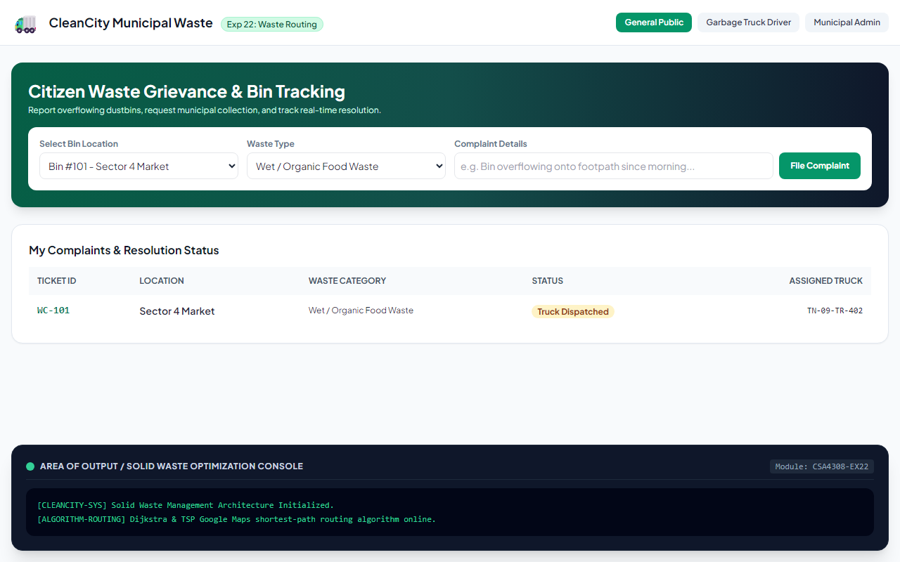

# Experiment 22: Solid Waste Management & Bin Routing

## Aim
To implement a smart Solid Waste Management platform optimizing waste segregation, collection, and transportation through algorithmic route assignment, driver load updates, and citizen complaint tracking.

---

## Problem Statement
Effective usage of dustbins and algorithmic routing through all necessary garbage bins to the dumping site.
- **Administrator**: Create/manage garbage bins, assign optimal routes to drivers, view reports, audit public complaints.
- **General Public**: Register, post waste overflow complaints, track resolution.
- **Driver**: Check daily work updates, follow optimal route, update garbage truck load.

---

## Output Screenshot
Below is the captured output of CleanCity Solid Waste Management:

---

## Conclusion
The Solid Waste Management system was successfully implemented, demonstrating shortest-path route planning, IoT sensor fill simulations, and multi-role operations.
