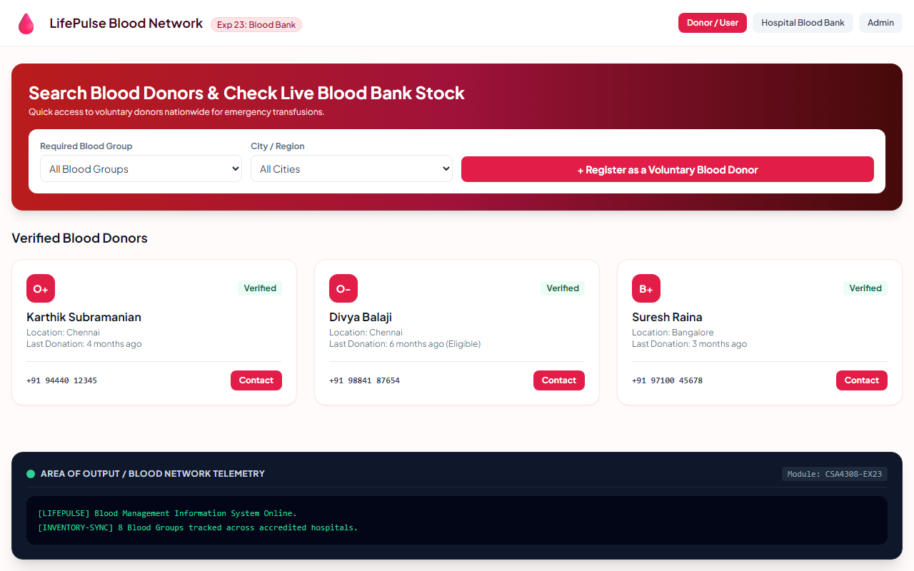

# Experiment 23: Blood Management Information System

## Aim
To implement a nationwide Blood Management Information System providing rapid querying of voluntary blood donors, enabling hospitals to manage blood bank units across all 8 ABO/Rh groups, and generating confidential medical reports.

---

## Problem Statement
The blood management information system offers quick access to donor records collected nationwide.
- **Donor / User**: Register donor information, search donor directory by blood group and city, query blood bank stock.
- **Hospital**: Post blood bank info, update blood group status (units), track emergency transfusion demand.
- **Admin**: Audit medical reports, monitor donation drives.

---

## Output Screenshot
Below is the captured output of the Blood Management Information System:

---

## Conclusion
The Blood Management System was successfully engineered, supporting emergency donor lookups and real-time hospital inventory tracking.
