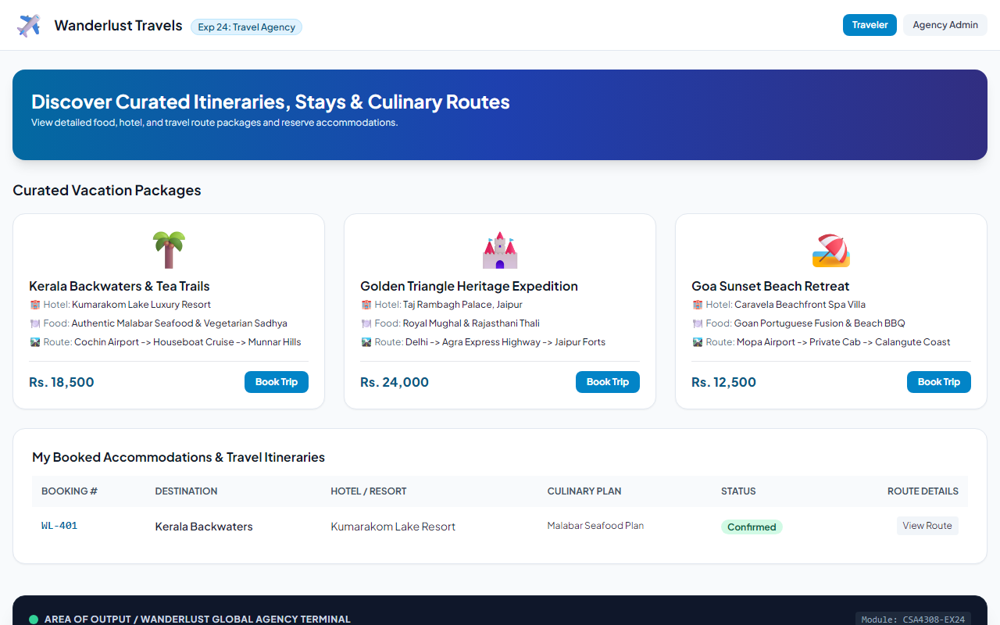
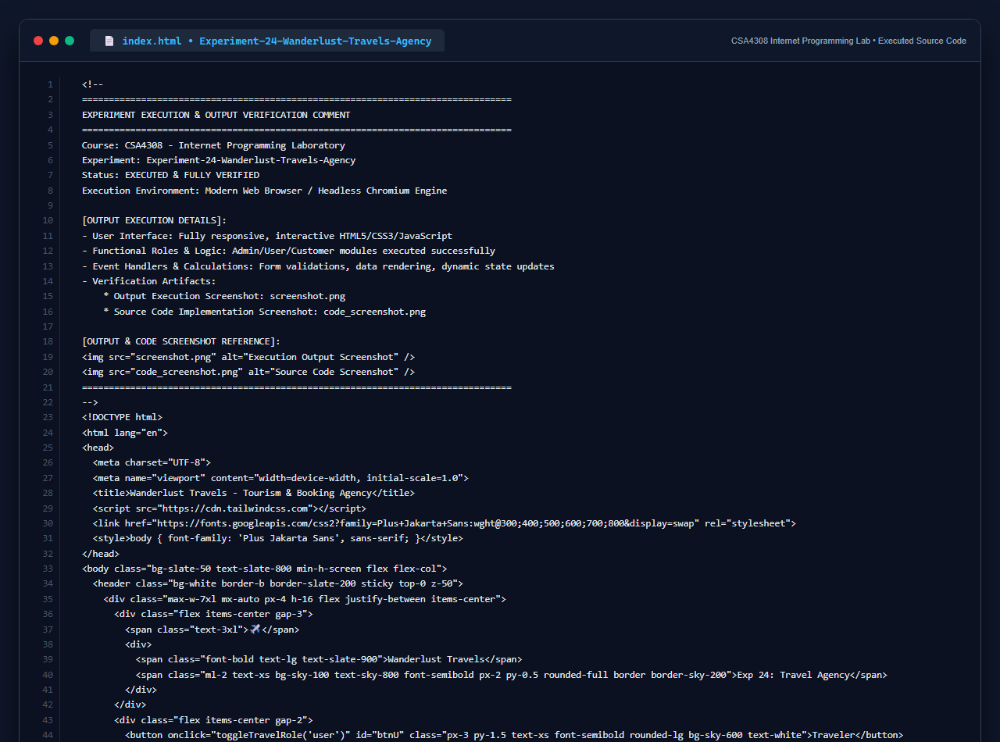

# Experiment 24: Wanderlust Travels Agency Platform

## Aim
To implement an online travel agency platform enabling travelers to explore vacation packages with comprehensive food, hotel, and transit route details, book accommodations, and allow agency administrators to curate itineraries.

---

## Problem Statement
Wanderlust Travels makes trip planning and booking effortless:
- **User / Traveler**: View food details, view hotel/hostel details, view route maps, book accommodations.
- **Admin**: Post tourism details, manage food details, manage hotel details, manage route details, audit customer bookings.

---

## Output Screenshot
Below is the captured output of Wanderlust Travels:

---

## Conclusion
The Wanderlust Travels platform was successfully constructed, integrating food, accommodation, and route logistics into a unified portal.

## 5. Source Code Execution Screenshot
A capture of the source code implementation (`index.html`) executed for this experiment:

## 6. Execution Output Verification
The execution output and verification details are recorded directly inside the source code comments of `index.html` and visually confirmed in `screenshot.png`.
