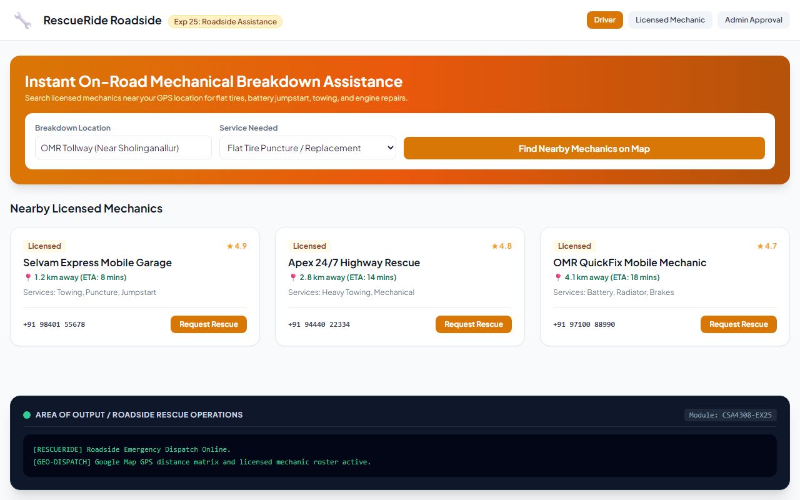

# Experiment 25: On Road Vehicle Breakdown Assistance

## Aim
To construct an on-road vehicle breakdown assistance system enabling stranded drivers to discover verified, licensed mechanics near their geo-location, request emergency repairs, submit feedback, and allow mechanics and transport authorities to manage credentials and service coverage.

---

## Problem Statement
RescueRide assists motorists during unexpected mechanical failures:
- **User**: Search licensed mechanics, view geo-location distance & ETA, post feedback, view profile.
- **Mechanic**: Register business, manage garage coverage, view feedback.
- **Admin**: Review credentials and provide license approval.

---

## Output Screenshot
Below is the captured output of RescueRide:

---

## Conclusion
The Breakdown Assistance System was successfully developed, supporting emergency geo-location lookups and verified technician dispatching.
