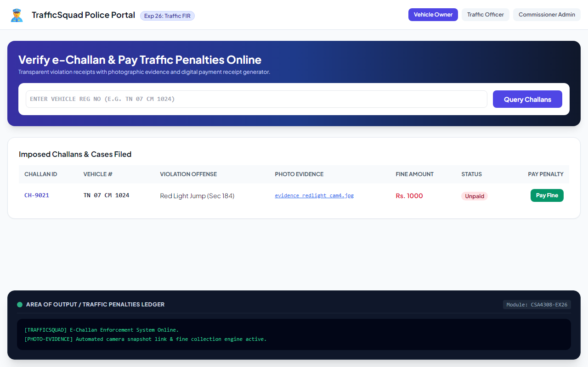

# Experiment 26: Traffic Police Squad FIR & Penalty Portal

## Aim
To develop a traffic enforcement web platform empowering police officers to file online FIR citations with photographic evidence, enabling vehicle owners to query and pay fines digitally, and facilitating administrative oversight.

---

## Problem Statement
Traffic Squad automates penalty collection:
- **Vehicle Owner / User**: View challans by vehicle registration number, view case details, pay penalty online.
- **Police Officer**: Traffic rules review, create traffic case/e-Challan with photographic proof, live traffic updates, Google Maps traffic link.
- **Admin**: Manage police credentials, monitor daily citation reports.

---

## Output Screenshot
Below is the captured output of Traffic Squad:

---

## Conclusion
The Traffic Squad portal was successfully created and verified, streamlining traffic penalty administration and enforcement transparency.
