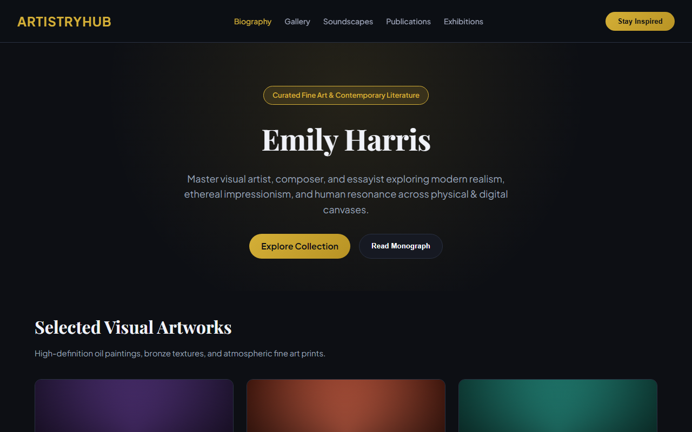
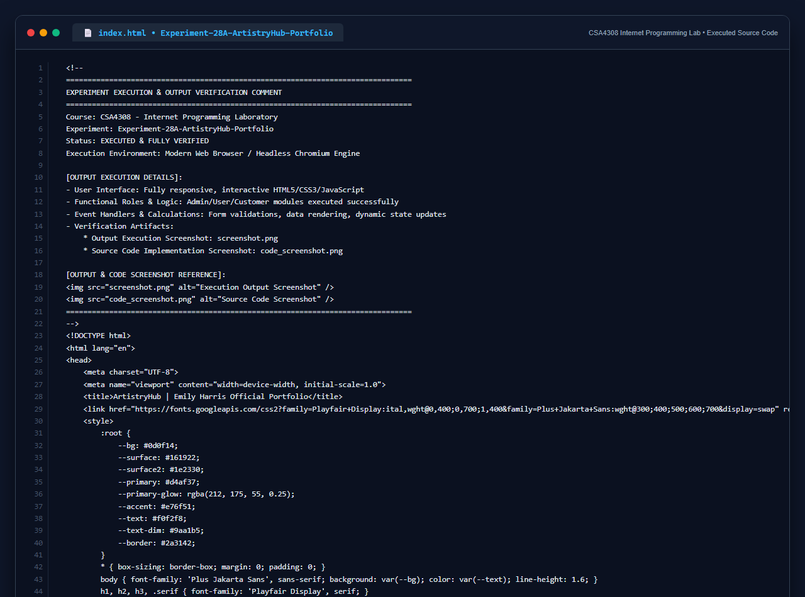

# Experiment 28A: ArtistryHub - Emily Harris Official Artist Portfolio

## 1. Overview
ArtistryHub is an artist portfolio website dedicated to showcasing the work, achievements, discography, and publications of artist **Emily Harris**.

## 2. Key Features
- **Homepage & Banner**: Curated fine art aesthetic with high-contrast luxury dark theme.
- **Biographical Profile**: Detailed artist journey, influences, and monograph.
- **Multidisciplinary Portfolio**: Visual oil/acrylic gallery, bronze sculpture highlights, and generative art.
- **Soundscapes & Media**: Embedded audio suite for acoustic piano compositions and live suite accompaniment.
- **Comprehensive Bibliography**: Indexed books, monographs, and ISBN registrations.
- **Newsletter Subscription**: Direct subscription mechanism for collector previews and exhibition invitations.

## 3. Technology Stack
- HTML5, Semantic Elements, CSS3 Grid/Flexbox
- Google Fonts (`Playfair Display`, `Plus Jakarta Sans`)
- Client-Side Interactive Media Controls and Validation

## 4. Output Demonstration

## 5. Source Code Execution Screenshot
A capture of the source code implementation (`index.html`) executed for this experiment:

## 6. Execution Output Verification
The execution output and verification details are recorded directly inside the source code comments of `index.html` and visually confirmed in `screenshot.png`.
