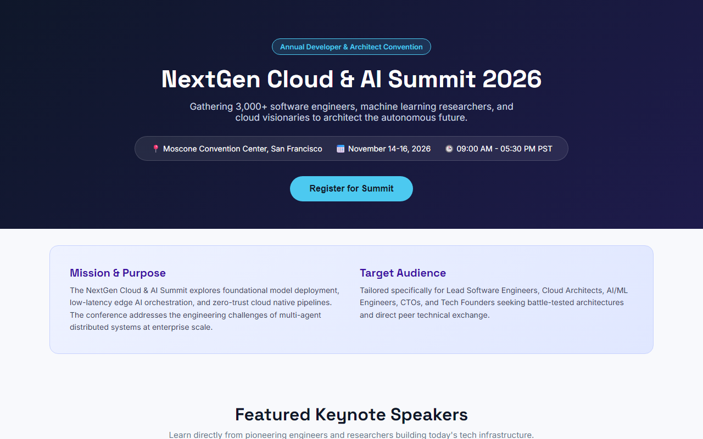

# Experiment 28B: Tech Event & Speaker Showcase Platform

## 1. Overview
A clean, modular tech event landing page providing complete conference schedule details, keynote speaker dossiers, event purpose, and target audience segments, paired with attendee ticket registration.

## 2. Core Functional Modules
- **Hero & Meta Banner**: Highlights venue, summit dates, conference hours, and call-to-action registration.
- **Purpose & Target Audience Chunking**: Clearly outlines conference technical mission (agentic AI, distributed systems) and intended attendee personas (CTOs, ML researchers, architects).
- **Keynote Speaker Profiles**: Interactive speaker cards with photos, institutional roles, bios, and talk abstract links.
- **Chronological Conference Agenda**: Modular session breakdown with timestamps, keynote titles, and presenter descriptions.
- **Registration Modal**: Ticket application capture with role categorization and instant confirmation alert.

## 3. Technology Stack
- HTML5, Modern CSS3 with CSS Variables, Flexbox, CSS Grid
- Typography: `Space Grotesk` & `Inter`
- Client-Side Modal Controller & Form Handling

## 4. Output Demonstration

