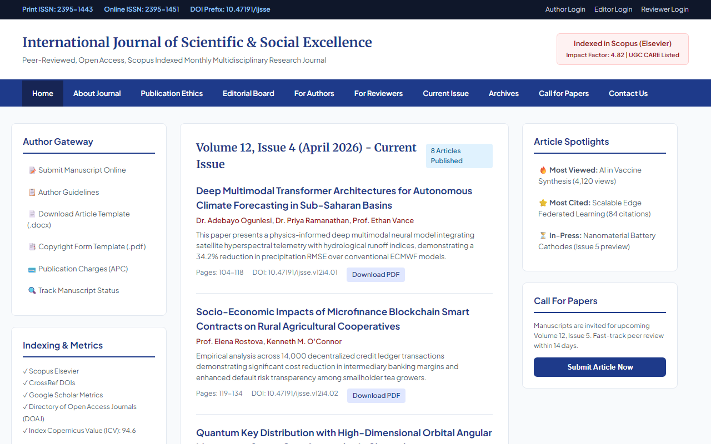
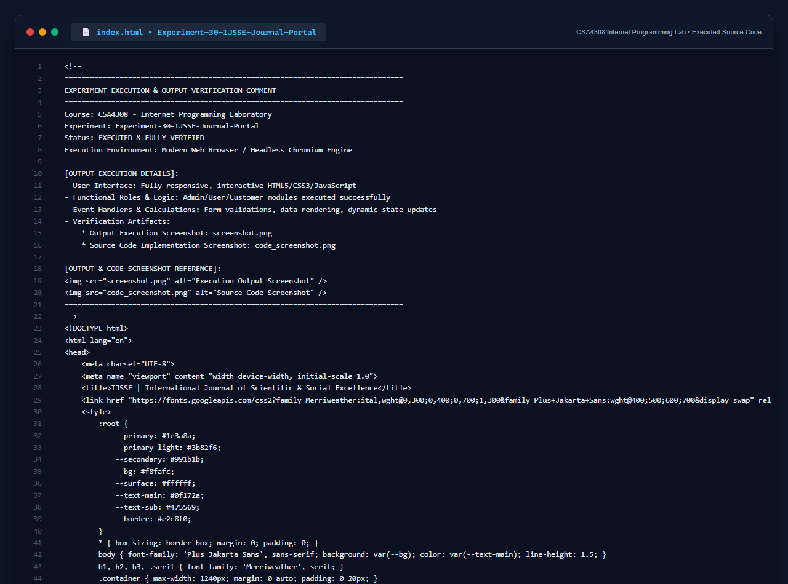

# Experiment 30: International Journal of Scientific & Social Excellence (IJSSE) Portal

## 1. Overview
A professional, Scopus-indexed academic journal publishing portal featuring ISSN cataloging (Print: 2395-1443, Online: 2395-1451), double-blind peer review orchestration, manuscript submission pipeline, and full-text article repositories.

## 2. Functional Modules
- **About Journal & ISSN Metrics**: Highlights aims, scope, Scopus impact factor, indexing accreditations, and ISSN registrations.
- **Author Services**: Manuscript submission, guidelines, Word article templates, copyright agreements, and article processing fee details.
- **Editorial & Reviewer Gateway**: Editor login, reviewer assignment, publication ethics (COPE compliance), and tracking dashboards.
- **Article Repositories**: Current issue directory, volume archives, most-cited metrics, most-viewed rankings, and articles in-press.
- **Call for Papers & Feedback**: Manuscript intake, quarterly notifications, and contact communication module.

## 3. Technology Stack
- HTML5, Semantic Academic Typography (`Merriweather` + `Plus Jakarta Sans`)
- CSS3 Card Grid Layout with Multi-Column Academic Structure
- Client-Side Navigation, Abstract Toggling, and Submission Handling

## 4. Output Demonstration

## 5. Source Code Execution Screenshot
A capture of the source code implementation (`index.html`) executed for this experiment:

## 6. Execution Output Verification
The execution output and verification details are recorded directly inside the source code comments of `index.html` and visually confirmed in `screenshot.png`.
