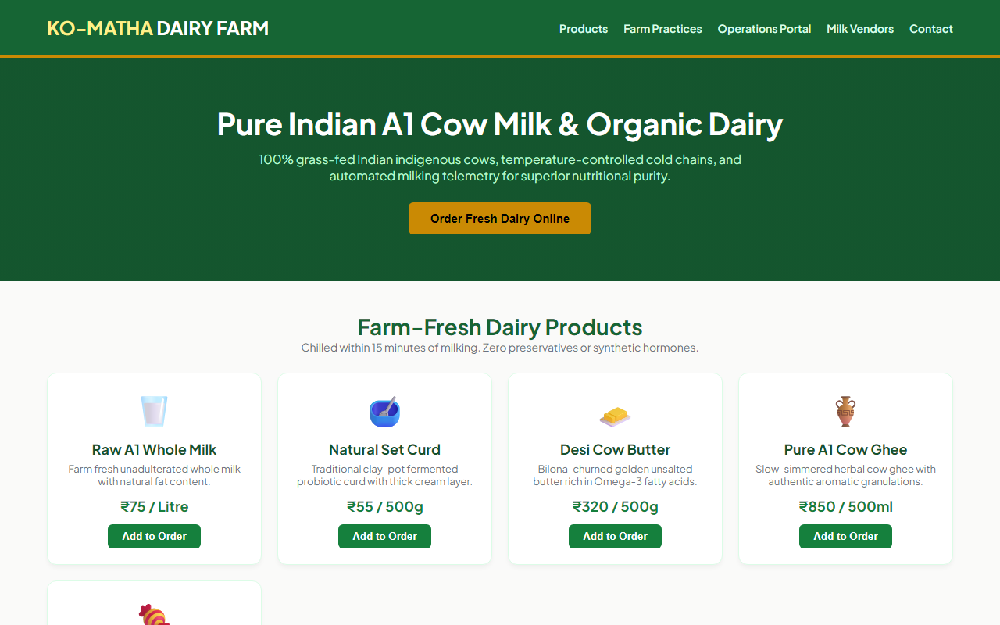

# Experiment 31: Ko-Matha Smart Dairy Farm Management System

## 1. Overview
Ko-Matha Smart Dairy Farm is a farm-to-table dairy portal and agricultural management system facilitating pure Indian A1 indigenous cow milk distribution, stock telemetry, vendor supply tracking, and subscription order scheduling.

## 2. Core Functional Requirements
- **Product Catalog**: Direct ordering for raw A1 milk, natural set curd, desi cow butter, herbal ghee, and traditional cova-sweets.
- **Admin Management & Authentication**: Secure administrator login, stock entry forms, and automated replenishment alerts.
- **Reporting Infrastructure**: Real-time daily yield tracking, monthly billing audits, and annual production quality metrics.
- **Milk Vendor & Herd Management**: Vendor profiles, cow breed tracking (Gir, Sahiwal, Kankrej), daily fat content telemetry, and vendor supply records.
- **Customer Purchase & Scheduling**: Delivery subscription management, checkout cart, and route tracking.

## 3. Technology Stack
- HTML5, Clean Responsive CSS3
- Real-Time Tabbed Data Viewers
- JavaScript State Management for Orders and Vendor Registries

## 4. Output Demonstration

