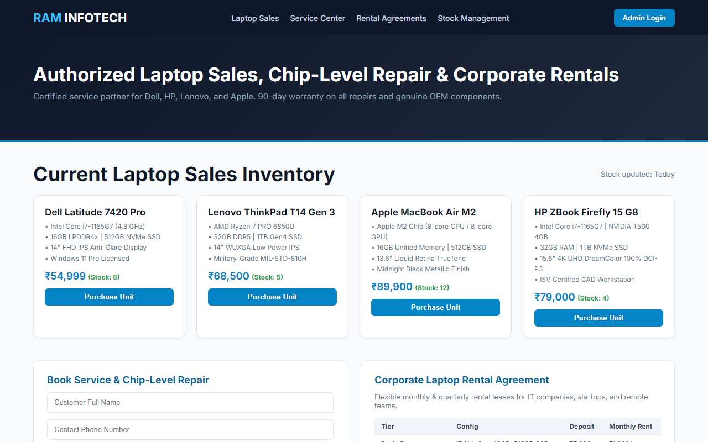

# Experiment 32: Ram Infotech Laptop Sales & Service Portal

## 1. Overview
A business management and customer engagement portal for Ram Infotech handling laptop sales inventory, chip-level repair scheduling, corporate hardware rental agreements, and component warehouse stock control.

## 2. Functional Capabilities
- **Sales Inventory**: Laptop catalog with detailed hardware configurations (CPUs, SSDs, displays, GPUs, licenses) and real-time stock levels.
- **Service Center & RMA Tracker**: Customer repair scheduling for motherboard chip-level repair, screen replacements, and automated job sheet generation.
- **Laptop Rental Lease Agreement**: Multi-tier corporate hardware leasing matrix with security deposit parameters and monthly billing rates.
- **Shop Stock Maintenance**: Real-time component parts tracking (logic boards, EDP display panels, OEM batteries) with threshold warnings.
- **Admin Control**: Authentication mechanism for administrative oversight and inventory adjustments.

## 3. Technology Stack
- HTML5 & Responsive Semantic Layout
- CSS3 Flexible Grids and Component Tables
- JavaScript Interactive RMA Form & Rental Dispatcher

## 4. Output Demonstration

