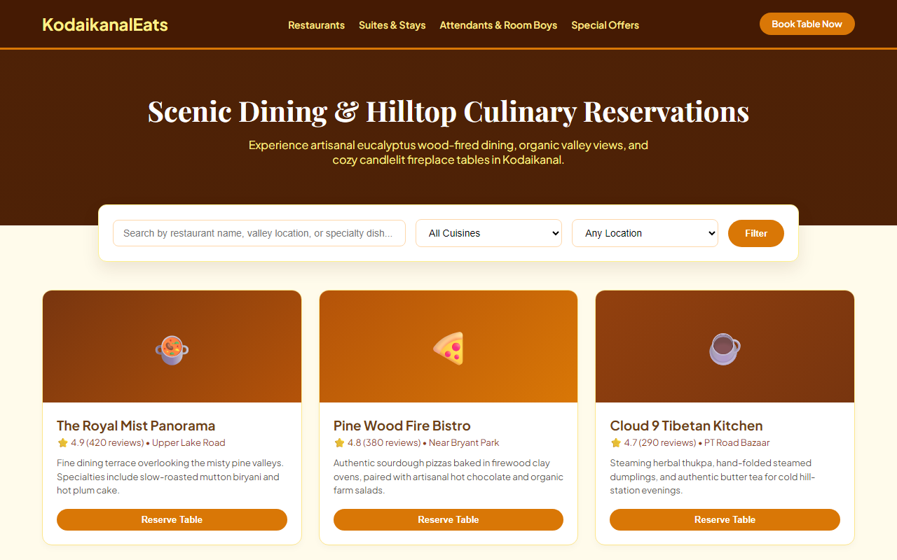
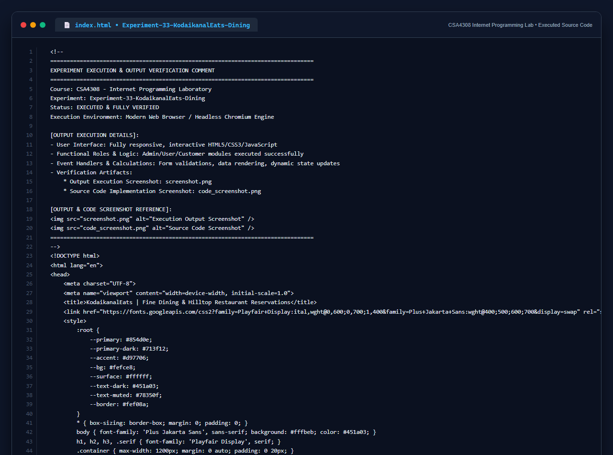

# Experiment 33: KodaikanalEats Dining & Table Booking Platform

## 1. Overview
KodaikanalEats is a dining reservation and resort management website tailored for travelers in the hill town of Kodaikanal, integrating restaurant table bookings, resort suite seasonal availability, and room attendant dispatching.

## 2. Core Functional Specifications
- **Restaurant Discovery & Filtering**: Search by cuisine (Chettinad, Tibetan, Woodfired, Continental), scenic ridge locations, and customer ratings.
- **Table Reservation System**: Slot selection, party size specification, and instant confirmation SMS simulation.
- **Suite Accommodation & Tariff Engine**: Room breakdown (Single, Double Deluxe, Presidential Fireplace Suite) with seasonal vs off-season dynamic pricing.
- **Room Boy & Staff Roster Maintenance**: Staff allocation tracking across resort wings, shift rotations, and live operational status.
- **Admin Control**: Centralized portal for managing table layouts, room vacancies, and customer profiles.

## 3. Technology Stack
- HTML5 & Responsive Semantic Elements
- Warm Hill-Station Palette (`Playfair Display`, `Plus Jakarta Sans`)
- Dynamic DOM Table Visualizers & Booking Logic

## 4. Output Demonstration

## 5. Source Code Execution Screenshot
A capture of the source code implementation (`index.html`) executed for this experiment:

## 6. Execution Output Verification
The execution output and verification details are recorded directly inside the source code comments of `index.html` and visually confirmed in `screenshot.png`.
