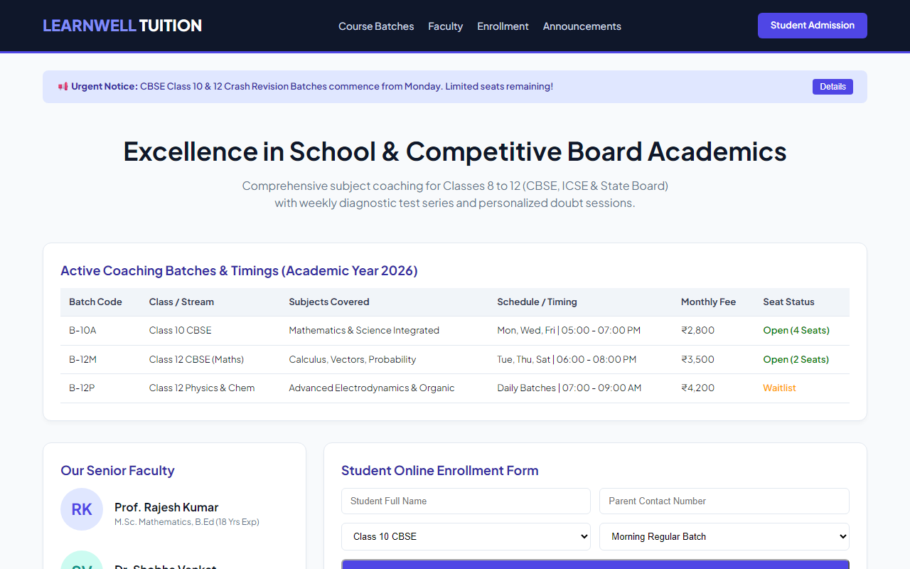

# Experiment 34: LearnWell Tuition Centre Management Portal

## 1. Overview
LearnWell Tuition Centre platform streamlines student admissions, academic announcements, faculty profiles, and batch timetable schedules for school and board examinations.

## 2. Core Functional Highlights
- **Noticeboard & Announcement System**: Real-time alerts for revision batches, exam schedules, and holiday notifications.
- **Batch Schedule & Fee Structure**: Clear transparency across class batches (Classes 10 & 12 CBSE/ICSE), weekly timings, and fee structures.
- **Faculty Directory**: Faculty credentials, academic specializations, and teaching background.
- **Online Admission & Registration**: Quick enrollment form capturing student profile, parent contact, class grade, and preferred batch timing.

## 3. Technology Stack
- HTML5 Semantic Architecture & Responsive CSS3
- Flexbox/Grid Layout Systems
- Client-side Enrollment Form Validation

## 4. Output Demonstration

