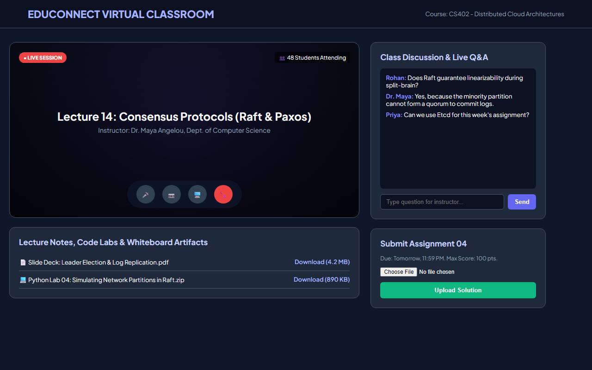

# Experiment 36A: EduConnect Virtual Classroom Platform

## 1. Overview
EduConnect is an interactive virtual classroom environment delivering real-time online lectures, live multimedia whiteboard sharing, student Q&A discussions, and course assignment submission pipelines.

## 2. Core Functional Specifications
- **Virtual Lecture Console**: Live video interface with mic, camera, screen-share controls, and student attendance counters.
- **Course Artifacts Repository**: Direct access to downloadable slide decks, lab code files, and lecture transcripts.
- **Live Classroom Q&A Stream**: Real-time student-instructor chat stream for instantaneous concept clarification.
- **Assignment Submission & Gradebook**: Digital upload portal with deadlines and automated submission confirmation.

## 3. Technology Stack
- HTML5 Responsive Media Architecture
- Modern Dark-Themed CSS3 Variables
- Real-time DOM Chat & Submission Handlers

## 4. Output Demonstration

