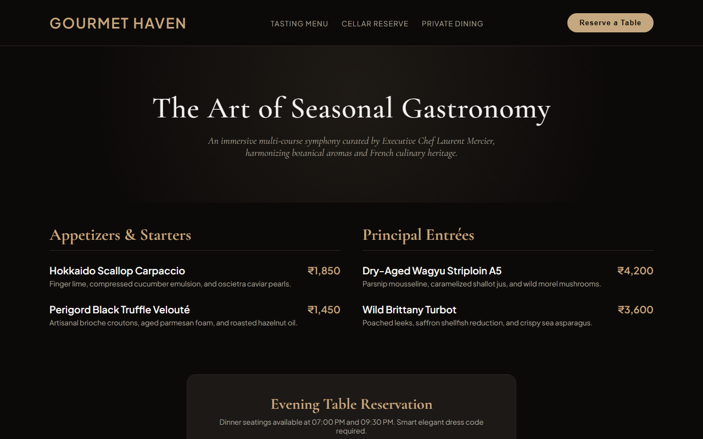

# Experiment 38: Gourmet Haven Fine Dining Restaurant

## 1. Overview
Gourmet Haven is an upscale digital dining destination showcasing seasonal French-European gastronomy tasting menus, rare cellar wine pairings, and online dinner table reservation orchestrations.

## 2. Core Functional Modules
- **Seasonal Multi-Course Tasting Menu**: Curated course selections (Hokkaido scallop carpaccio, black truffle velouté, Wagyu A5 striploin, Brittany turbot) with transparent pricing.
- **Atmospheric Visual Luxury Design**: Deep charcoal and champagne gold styling featuring `Cormorant Garamond` serif luxury typography.
- **Table Reservation System**: Seating date selection, guest party size specifications (including private alcoves), and automated confirmation alerts.
- **Cellar Reserve & Private Dining Enquiries**: Dedicated information channels for sommelier pairings and private celebration hosting.

## 3. Technology Stack
- Semantic HTML5, CSS3 Luxury Dark Palettes
- Responsive Multi-Column Course Grids
- Client-Side Reservation Validation

## 4. Output Demonstration

