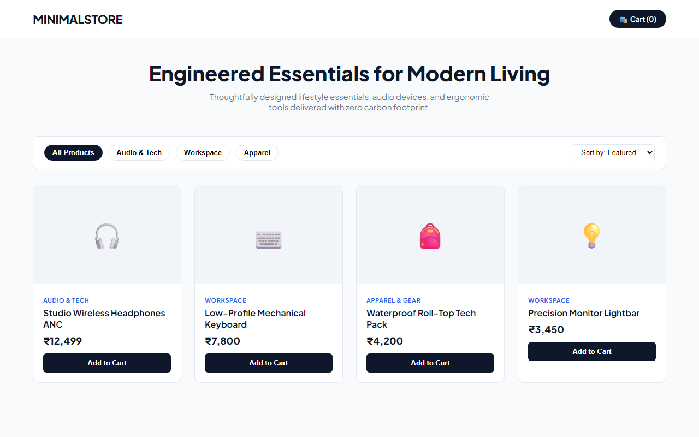

# Experiment 39: Clean Modern E-Commerce Catalog & Store

## 1. Overview
MinimalStore is a clean and straightforward modern e-commerce storefront featuring categorized product catalogs, responsive grid layouts, dynamic cart counters, and instant checkout orchestration.

## 2. Key Features
- **Clean Responsive Product Catalog**: Clear typography, product categorization tags, and pricing badges.
- **Category Filtering & Sorting**: Intuitive tab controls for quick switching between tech, workspace, and apparel gear.
- **Dynamic Shopping Cart**: Real-time basket tally updating running invoice totals.
- **Instant Checkout Simulator**: Validates item counts and simulates secure order fulfillment.

## 3. Technology Stack
- HTML5 & CSS3 Flexbox/Grid
- Responsive Mobile-First Architecture
- Lightweight JavaScript Cart State Controller

## 4. Output Demonstration

