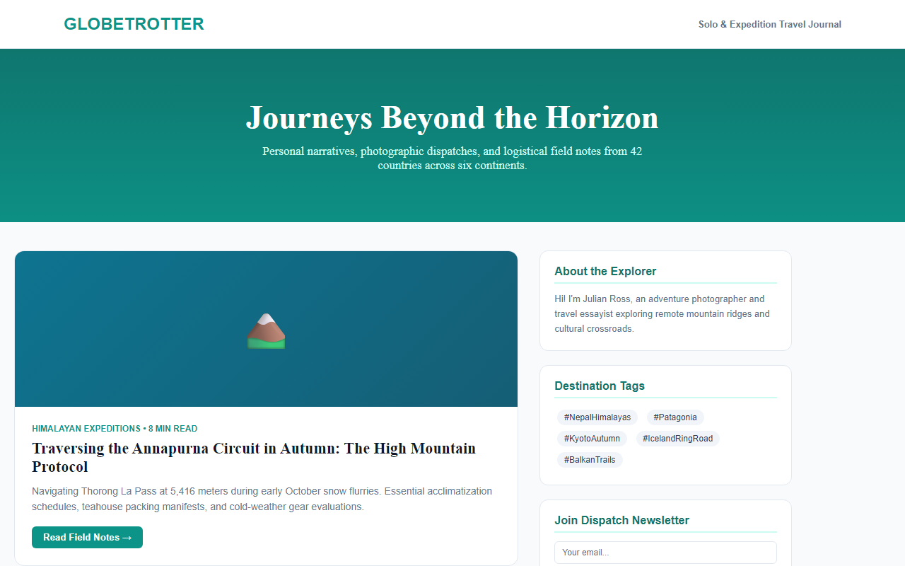

# Experiment 40: GlobeTrotter Travel Narrative Blog

## 1. Overview
GlobeTrotter is a travel storytelling and destination guide platform documenting expeditions, trekking field notes, logistical itineraries, and photography dispatches.

## 2. Core Functional Specifications
- **Expedition Dispatches**: Long-form travel articles with altitude metadata, reading time tags, and logistical breakdowns.
- **Destination Tagging**: Thematic exploration tags for mountain passes, desert journeys, and cultural trails.
- **Author Profile & Philosophy**: Explorer dossier highlighting background and photography field experience.
- **Dispatch Newsletter**: Subscriber integration for monthly travel guides and packing checklists.

## 3. Technology Stack
- HTML5 Semantic Architecture & Serif Title Typography (`Playfair Display`)
- Responsive Two-Column Blog Grid (Main Narrative + Sidebar)
- Client-Side Article Reader Interactions

## 4. Output Demonstration

