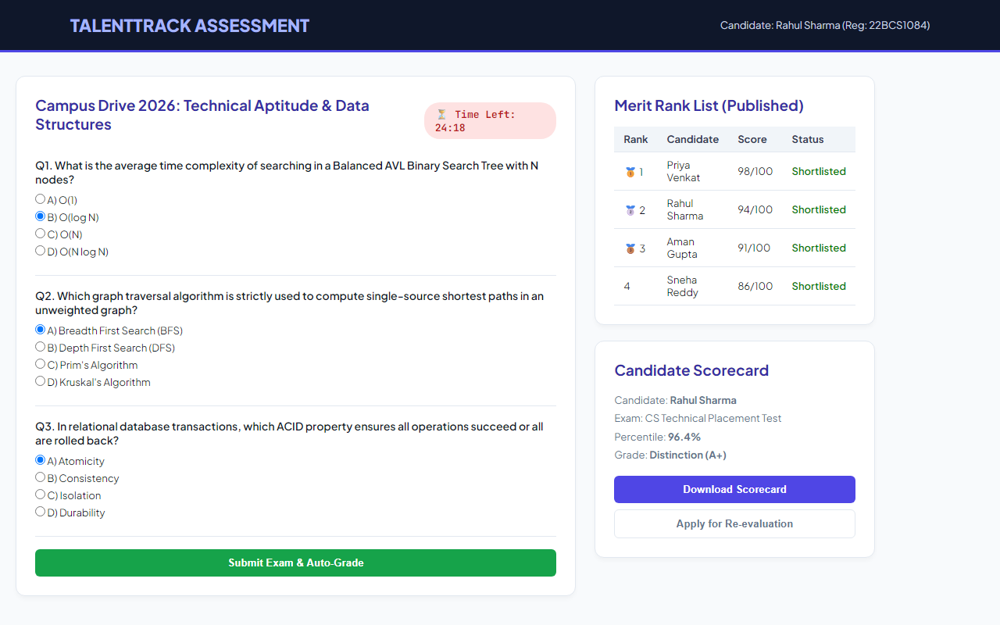

# Experiment 43: Online Placement Assessment Portal

## 1. Overview
TalentTrack is a campus recruitment placement assessment platform facilitating candidate authorization, timed technical testing, automated grading, live merit rank publication, scorecard downloads, and re-evaluation appeals.

## 2. Core Functional Specifications
- **Candidate Authorization & Timed Test**: Authenticated candidate access with a countdown timer and randomized technical question sets.
- **Automated Grading Engine**: Immediate grading upon submission with detailed answer key explanations.
- **Rankings & Merit Leaderboard**: Published institutional ranks with qualification thresholds for corporate interviews.
- **Scorecard PDF & Re-evaluation**: Certified scorecard generation and academic grievance submission channel.

## 3. Technology Stack
- HTML5, CSS3 Custom Properties
- JavaScript Timed Evaluation Logic
- Real-time Assessment State & Scorecard Dispatches

## 4. Output Demonstration

