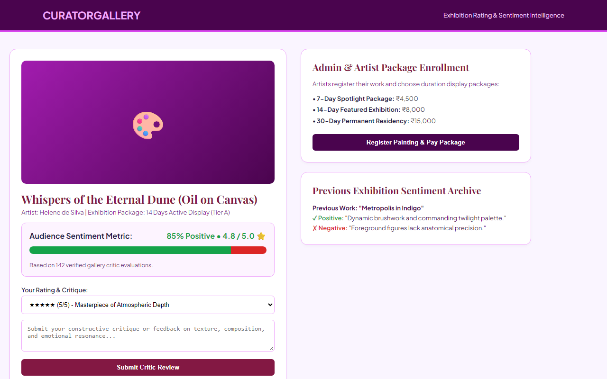
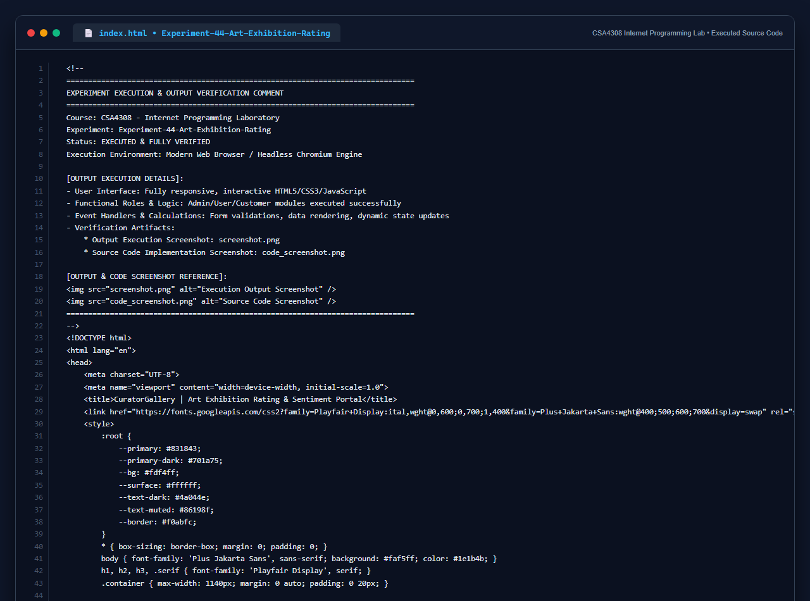

# Experiment 44: Art Exhibition Rating & Review Portal

## 1. Overview
CuratorGallery enables exhibition curation, artist package duration monetization, visitor critique collection, and automated sentiment analysis visualization.

## 2. Core Functional Requirements
- **Painting Showcase & Sentiment Engine**: High-fidelity art showcase with percentage-based positive/negative sentiment metric bars.
- **Visitor Rating & Review Collection**: Dynamic star rating and critique intake with instant sentiment tabulation.
- **Exhibition Duration Monetization Packages**: Tiered exhibition slots (7-day, 14-day, 30-day) with integrated pricing and registration.
- **Historical Painting Sentiment Archive**: Displays positive and negative summaries of prior paintings before scheduling new canvases.

## 3. Technology Stack
- HTML5 Semantic Architecture & Serif Typography (`Playfair Display`)
- Responsive Two-Column Sentiment Dashboard
- Client-Side Review Handling & Visual Sentiment Telemetry

## 4. Output Demonstration

## 5. Source Code Execution Screenshot
A capture of the source code implementation (`index.html`) executed for this experiment:

## 6. Execution Output Verification
The execution output and verification details are recorded directly inside the source code comments of `index.html` and visually confirmed in `screenshot.png`.
