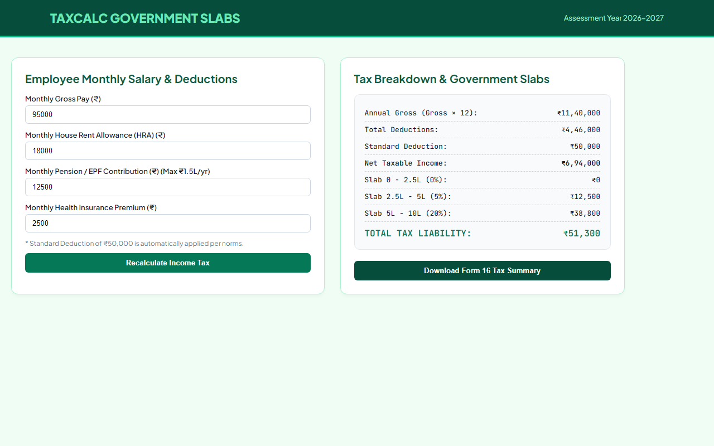

# Experiment 45: Income Tax Calculator with Government Slabs

## 1. Overview
TaxCalc Pro implements the official government statutory income tax calculation algorithm with full support for monthly deductions, standard deductions, HRA exemptions, pension caps, and tiered progressive tax slabs.

## 2. Mathematical Norms & Government Rules
- **Net Taxable Income Equation**:
  $$\text{Net Taxable} = (\text{Gross} \times 12) - (\text{HRA} \times 12) - 50,000 - \min(\text{Pension} \times 12, 150,000) - (\text{Health Ins} \times 12)$$
- **Rebate Threshold**: If Net Taxable Income $\le ₹500,000$, total tax liability is **NIL**.
- **Progressive Slab Rates**:
  - $0$ to $₹250,000$: $0\%$
  - $₹250,001$ to $₹500,000$: $5\% \times (\text{Net Taxable} - 250,000)$
  - $₹500,001$ to $₹1,000,000$: $₹12,500 + 20\% \times (\text{Net Taxable} - 500,000)$
  - Above $₹1,000,000$: $₹112,500 + 30\% \times (\text{Net Taxable} - 1,000,000)$

## 3. Technology Stack
- HTML5, CSS3 Clean Emerald Aesthetics
- Monospace Financial Ledger Formatting (`JetBrains Mono`)
- JavaScript Live Calculation Engine & Form 16 Exporter

## 4. Output Demonstration

