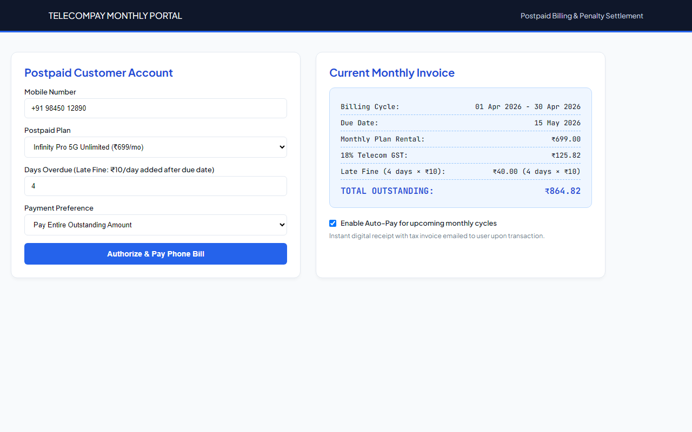
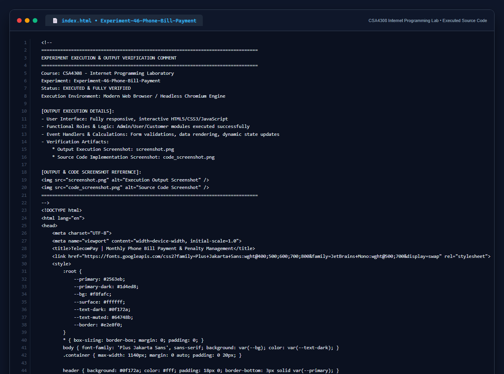

# Experiment 46: Monthly Phone Bill Payment System

## 1. Overview
TelecomPay delivers a full postpaid monthly mobile billing portal featuring monthly cycle duration dates, custom partial or full payment options, late penalty calculations (₹10/day), and recurring auto-pay management.

## 2. Core Functional Requirements
- **Billing Duration & Due Dates**: Displays active monthly cycle (start date to end date) and payment due date.
- **Late Payment Penalty**: Automatically computes and levies ₹10 per day fine for payments past the due date.
- **Full vs Custom Payment Selection**: Enables flexible partial clearing or complete settlement of outstanding totals.
- **Recurring Payments & Receipting**: Auto-pay setup checkbox and digital tax receipt generation.

## 3. Technology Stack
- HTML5, CSS3 Custom Properties
- Monospace Financial Invoice Layout (`JetBrains Mono`)
- Dynamic DOM Real-Time Billing & Penalty Calculation

## 4. Output Demonstration

## 5. Source Code Execution Screenshot
A capture of the source code implementation (`index.html`) executed for this experiment:

## 6. Execution Output Verification
The execution output and verification details are recorded directly inside the source code comments of `index.html` and visually confirmed in `screenshot.png`.
